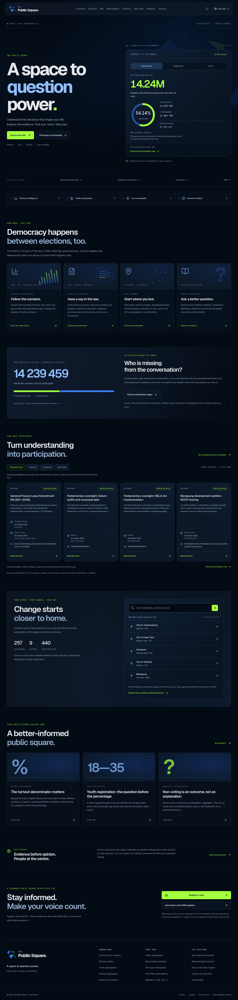

# The Public Square website

**A space to question power.** The website follows the supplied navy, blue and lime identity and connects all existing electoral, civic-participation, municipal-directory and research features.

These are screenshots of the verified production website. They show the design; the running website provides its interactive previews, filters, searches and downloads.

[Desktop preview](previews/desktop.png) · [Phone preview](previews/mobile.png) · [Put the website online](publish-website.md)

## Desktop

## Phone

